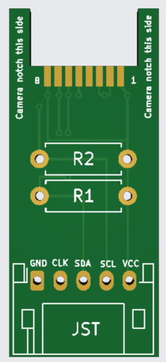
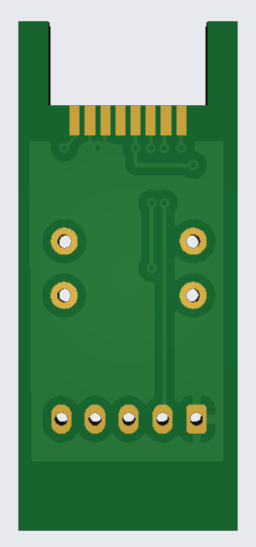
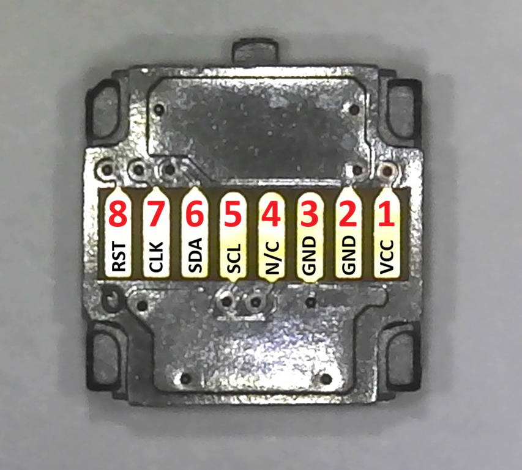
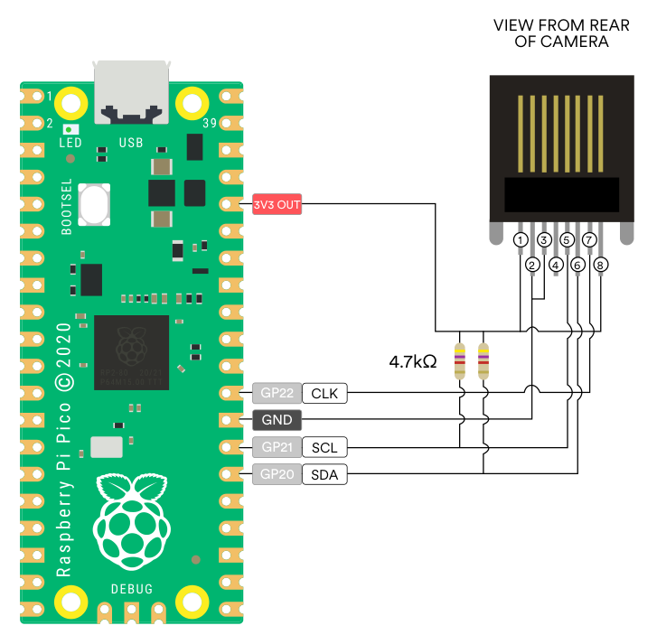
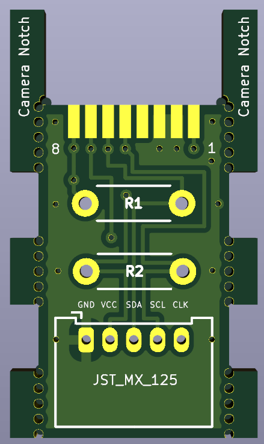
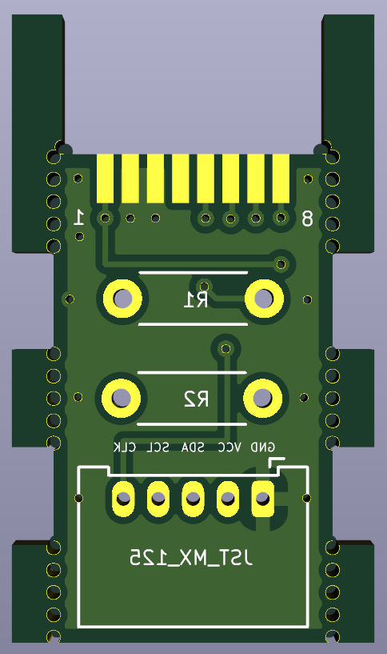

# I2C (OpenFIRE) DIY Wiimote IR Camera PCB

  <table align="center">
    <tr>
      <td align="center"><b>Variant Layout</b></td>
      <td align="center"><b>PCB Front View</b></td>
      <td align="center"><b>PCB Back View</b></td>
      <td align="center"><b>Camera Pin Labels & OpenFIRE Wiring Diagram</b></td>
    </tr>
    <tr>
      <td align="center" valign="middle"><b>JST PH 2.0</b> (1/4W Resistors) PCB Size 13*30.1 mm</td>
      <td align="center" valign="middle">
        
      </td>
      <td align="center" valign="middle">
        
      </td>
      <td align="center" valign="middle" rowspan="2">
        
          
        
      </td>
    </tr>
    <tr>
      <td align="center" valign="middle"><b>JST MX 1.25</b> (1/8W Resistors) PCB Size 13*22.5 mm</td>
      <td align="center" valign="middle">
        
      </td>
      <td align="center" valign="middle">
        
      </td>
    </tr>
  </table>

## ⚠️ PRELIMINARY DESIGN NOTICE
This PCB design has just been created and recently ordered with JLCPCB. It has not yet been physically tested or hand-assembled. However, the circuit topology is exceptionally simple and directly follows verified OpenFIRE community documentation, so it is highly anticipated to work without issues. Build at your own discretion while physical validation is underway!

## 📦 What's Included
This release contains **two untested variant versions** of the board layout:

* **JST PH 2.0 Variant:** Utilizes a standard JST PH 2.0mm connector layout and uses **1/4 watt resistors**.
* **JST MX 1.25 Variant (Compact):** Redesigned down to match **eatnooM's** compact PCB footprint size. This specific variant switches the connector layout to a JST MX 1.25mm format and uses **1/8 watt resistors**.

## 🛠️ Assets
Download the corresponding Gerber zip files below depending on your preferred connector type and size layout constraint.

---

## 🎗️ Credits & Attribution
This hardware design is an evolutionary community effort built upon the foundations laid by local open-source creators:
* **Circuit Architecture:** Derived from and heavily based on the open-source layout by **[@eatnooM](https://github.com/eatnooM)** ([eatnooM/pixart-sensor-adapter](https://github.com/eatnooM/pixart-sensor-adapter)).
* **3D Enclosure Development:** Enclosure integrations, printing assets, and specialized repository files are hosted, maintained, and credited to **[@slikvik55](https://github.com/slikvik55)** ([slikvik55/Lightgun3DParts](https://github.com/slikvik55/Lightgun3DParts)).
* **Assembly Tools:** Special thanks to **Gzus348** for creating the original camera jig design that makes sensor alignment straightforward.

---

## 🚀 Key Features

* **Beginner-Friendly Through-Hole Resistors:** Uses through-hole resistors (4.7kΩ) for easy hand-soldering and a slim profile.
* **Official Hardware Guide Aligned:** The trace layout is designed directly from the "DIY Wiimote Conversion (Using Clock Pin)" schematic on **page 4** of the official **[OpenFIRE-Hardware-Guide_1.3.pdf](https://openfirelightgun.org/wp-content/uploads/2026/10/OpenFIRE-Hardware-Guide_1.3.pdf)** manual.
* **Optional 5-Pin JST Connector:** Physical JST socket will fit inside the barrel shell (JST MX 1.25)
* **Enclosure-Ready Geometry:** Formatted specifically to seat right into RetroMidget's Wiimote camera housing using standard dimensions from @slikvik55's Lightgun3DParts repository.
* **Zero Onboard Crystal Needed:** Relies on OpenFIRE's native pin-generated clock (`CLK`), omitting external oscillators.
* **Direct 3.3V Power Line:** Streamlined 3.3V power path supplied directly by a Raspberry Pi Pico.

---

## 📐 3D Shell Compatibility & Enclosure Notes

Tailored for **RetroMidget's Wiimote Camera Enclosure** using assets from [@slikvik55's Lightgun3DParts Repository](https://github.com/slikvik55/Lightgun3DParts/tree/main/WiiCamEnclosure):
* 📥 **Main Shell:** [WiiCamEnclosure Barrel STL](https://github.com/slikvik55/Lightgun3DParts/blob/main/WiiCamEnclosure/Barrel.stl)
* 📥 **Internal Mount:** [Camera Holder STL](https://github.com/slikvik55/Lightgun3DParts/blob/main/WiiCamEnclosure/CamHolder.stl)
* 📥 **Assembly Tool:** [Soldering Alignment Jig STL from **Gzus348**](https://github.com/eatnooM/pixart-sensor-adapter/blob/main/inline/printables/Wii-IR-camera-solder-guideGun4IR-v7.stl)

### Assembly & Soldering Tips:
* **Wii IR Plastic Placement:** Remember to salvage the original dark translucent **Wii IR plastic screen** from the front of the donor Wii remote shell. It needs to be **cut to fit** cleanly inside the [Camera Holder](https://github.com/slikvik55/Lightgun3DParts/blob/main/WiiCamEnclosure/CamHolder.stl) piece during assembly. This lens acts as an essential optical filter that blocks ambient room light, ensuring the camera tracks only pure infrared lightbar signals.
* **Flux Recommendation:** Use high-quality flux like **Chip Quik SMD291** when soldering the Wii IR camera onto the PCB.
* **Soldering Assist:** Print and use the [Soldering Alignment Jig](https://github.com/eatnooM/pixart-sensor-adapter/blob/main/inline/printables/Wii-IR-camera-solder-guideGun4IR-v7.stl) to maintain flush alignment.

---

## 🛠 Ordering & Assembly Instructions

### PCB Ordering Specifications
⚠️ **CRITICAL FABRICATION NOTE:** When ordering from fabricators like **JLCPCB (Preferred)**, PCBWay, or OSH Park, you **MUST specify a PCB Thickness of 0.8mm**, standard 1.6mm thickness boards are too thick and will not go through the Jig and Barrel!

* **Layers:** 2-layer
* **Thickness:** 0.8 mm (Do not use standard 1.6mm!)
* **Surface Finish:** HASL Lead-Free or ENIG (Recommended)

### Bill of Materials (BOM)
* **U1:** Salvaged Nintendo Wiimote IR Camera Sensor
* **R1:** 4.7kΩ Through-Hole Metal Film Resistor 
* **R2:** 4.7kΩ Through-Hole Metal Film Resistor
* **JST (Optional):** 5-pin JST (PH 2.0 or MX 1.25) Connector (GND, VCC, SDA, SCL, CLK)

## 📌 Wiring Diagram Alignment

Ensure the Raspberry Pi Pico pinouts map directly to the corresponding board output lines. While you can configure your own pinouts in firmware, here is the recommended standard layout:

* **GND:** Connect board **GND** ➔ Raspberry Pi Pico **GND** (Any ground pin)
* **VCC:** Connect board **VCC** ➔ Raspberry Pi Pico **3V3 OUT**
* **SDA:** Connect board **SDA** ➔ Raspberry Pi Pico **GP20**
* **SCL:** Connect board **SCL** ➔ Raspberry Pi Pico **GP21**
* **CLK:** Connect board **CLK** ➔ Raspberry Pi Pico **GP22**
  *(💡 Note: GP22 is the suggested pin-out. Clock pin will need to be set in the OpenFIRE application).*

---

## 📜 License
Following the upstream license of the original work, this project is licensed under the **Creative Commons Attribution-ShareAlike 4.0 International License (CC BY-SA 4.0)**. You are free to share and adapt this work as long as you provide appropriate attribution and distribute your contributions under the same license.
