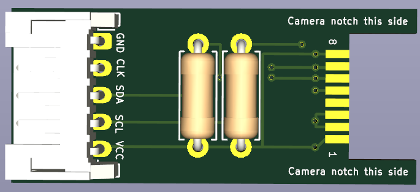
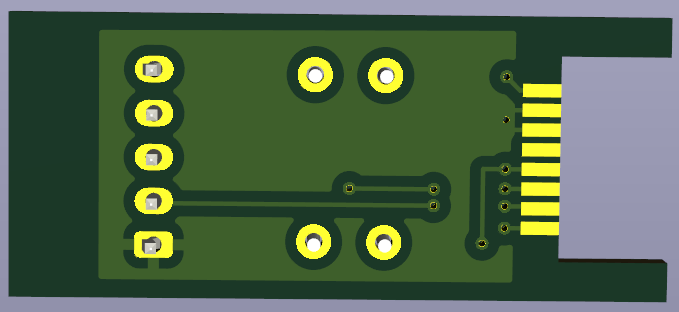

# OpenFIRE DIY Wiimote IR Camera PCB

  <table align="center">
    <tr>
      <td align="center"><b>PCB Layout Views</b></td>
      <td align="center"><b>OpenFIRE Wiring Diagram</b></td>
    </tr>
    <tr>
      <td align="center" valign="middle">
        
          
        
      </td>
      <td align="center" valign="middle">
        
      </td>
    </tr>
  </table>

⚠️ **PRELIMINARY DESIGN NOTICE**
This PCB design has just been created and recently ordered with **JLCPCB**. It has **not yet been physically tested** or hand-assembled. However, the circuit topology is exceptionally simple and directly follows verified OpenFIRE community documentation, so it is highly anticipated to work without issues. Build at your own discretion while physical validation is underway!

---

## 🎗️ Credits & Attribution
This hardware design is an evolutionary community effort built upon the foundations laid by local open-source creators:
* **Circuit Architecture:** Derived from and heavily based on the open-source layout by **[@eatnooM](https://github.com/eatnooM)** ([eatnooM/pixart-sensor-adapter](https://github.com/eatnooM/pixart-sensor-adapter)).
* **3D Enclosure Development:** Enclosure integrations, printing assets, and specialized repository files are hosted, maintained, and credited to **[@slikvik55](https://github.com/slikvik55)** ([slikvik55/Lightgun3DParts](https://github.com/slikvik55/Lightgun3DParts)).
* **Assembly Tools:** Special thanks to **Gzus348** for creating the original camera jig design that makes sensor alignment straightforward.

---

## 🚀 Key Features of This Variant

* **Beginner-Friendly Through-Hole Resistors:** Designed specifically to fit standard **through-hole 1/4 Watt axial resistors** instead of tiny SMD footprints. This makes hand-soldering incredibly easy for DIY makers.
* **Optional 5-Pin JST Connector:** Features an elongated breakout footprint with an integrated JST connector layout. Populating the physical JST socket is completely optional; if you are squeezing the board into an extremely tight shell, you can bypass the connector entirely and solder hookup wire directly to the exposed through-hole pads.
* **Zero Onboard Crystal Needed:** Takes advantage of OpenFIRE's native pin-generated clock signal (`CLK`), completely eliminating the bulky external crystal oscillator and its tuning capacitors.
* **Direct 3.3V Power Line:** Designed around a streamlined 3.3V input power path setup directly supplied by your main OpenFIRE controller hub.

---

## 📐 3D Shell Compatibility & Enclosure Notes

This PCB layout is specifically tailored to fit **RetroMidget's Wiimote Camera Enclosure**. 

### Required 3D Assets:
The printable files are managed in [@slikvik55's Lightgun3DParts Repository](https://github.com/slikvik55/Lightgun3DParts/tree/main/WiiCamEnclosure). Download the individual components here:
* 📥 **Main Shell:** [WiiCamEnclosure Barrel STL](https://github.com)
* 📥 **Internal Mount:** [Camera Holder STL](https://github.com)
* 📥 **Assembly Tool:** [Soldering Alignment Jig STL](https://github.com)

### Assembly Tips:
* **Soldering Assist:** It can be tedious to align the salvaged camera sensor pins manually. It is highly recommended to print the [Soldering Jig](https://github.com) ahead of time to hold the alignment perfectly flush while bonding it to the PCB pads.
* **JST Alignment:** The board's output section is extended so that the optional JST connector socket can neatly pass through the rear opening of the enclosure barrel.

---

## 🛠 Ordering & Assembly Instructions

### PCB Ordering Specifications
⚠️ **CRITICAL FABRICATION NOTE:** When ordering from fabricators like **JLCPCB (Preferred)**, PCBWay, or OSH Park, you **MUST specify a PCB Thickness of 0.8mm**. Standard 1.6mm thickness boards are too thick; the camera's rear header pins will not pass completely through the board to reach the solder pads!

* **Layers:** 2-layer
* **Thickness:** 0.8 mm (Do not use standard 1.6mm!)
* **Surface Finish:** HASL Lead-Free or ENIG (Recommended)

### Bill of Materials (BOM)
* **U1:** Salvaged Nintendo Wiimote IR Camera Sensor
* **R1:** 4.7kΩ Through-Hole Resistor (**1/4 Watt / Axial**)
* **R2:** 4.7kΩ Through-Hole Resistor (**1/4 Watt / Axial**)
* **JST (Optional):** 5-pin JST PH 2.0 Connector (GND, CLK, SDA, SCL, VCC)

## 📌 Wiring Diagram Alignment
Ensure your microcontroller pinouts map directly to the corresponding board output lines:
* **VCC:** Connect to `3V3 OUT`
* **CLK:** Connect to your configured Clock generation pin (e.g., `GP22`)
* **GND:** Connect to `GND`
* **SCL:** Connect I2C SCL (e.g., `GP21`)
* **SDA:** Connect I2C SDA (e.g., `GP20`)

---

## 📜 License
Following the upstream license of the original work, this project is licensed under the **Creative Commons Attribution-ShareAlike 4.0 International License (CC BY-SA 4.0)**. You are free to share and adapt this work as long as you provide appropriate attribution and distribute your contributions under the same license.
